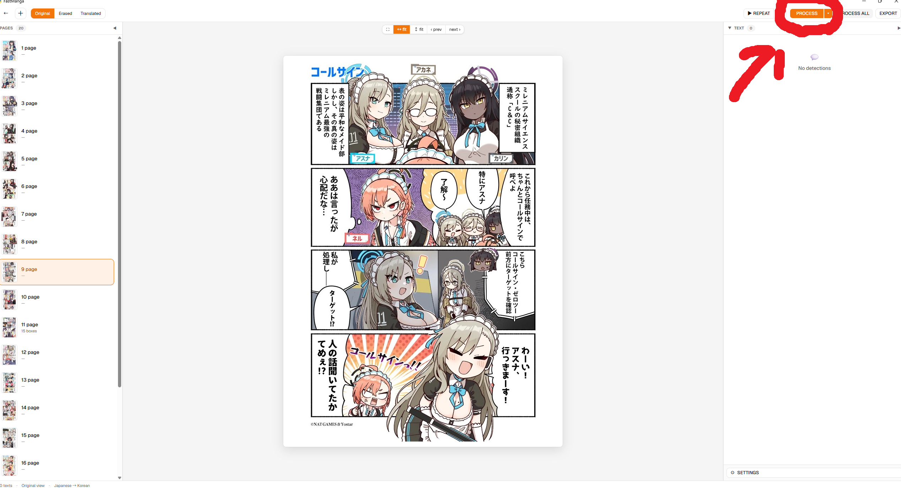
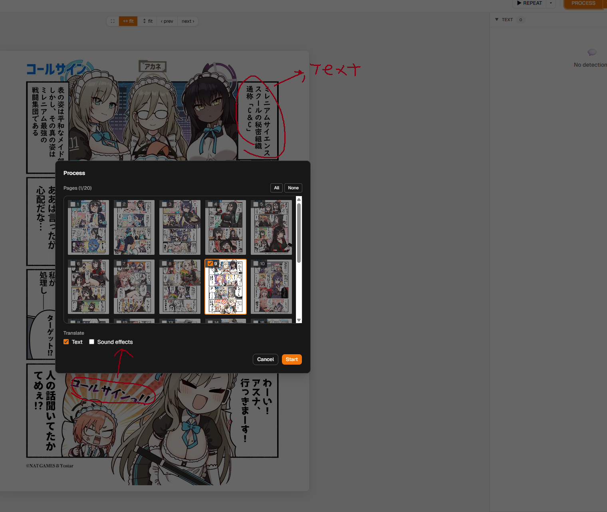
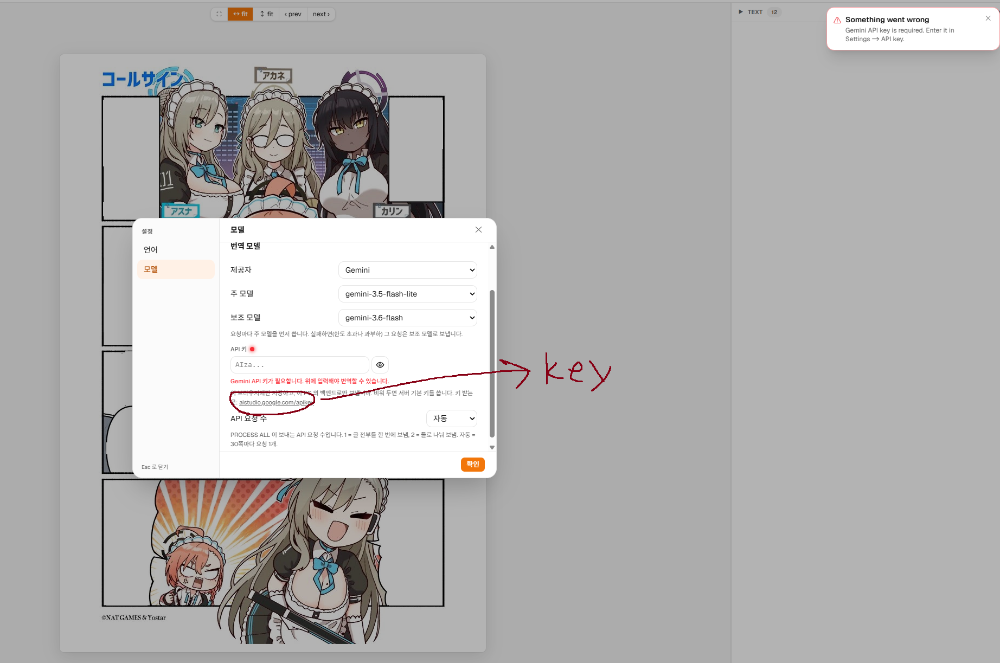
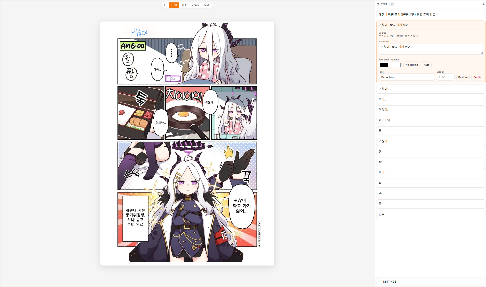
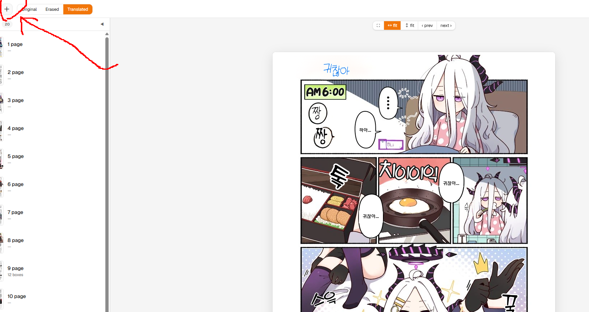
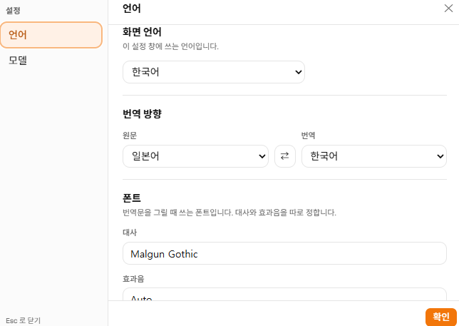
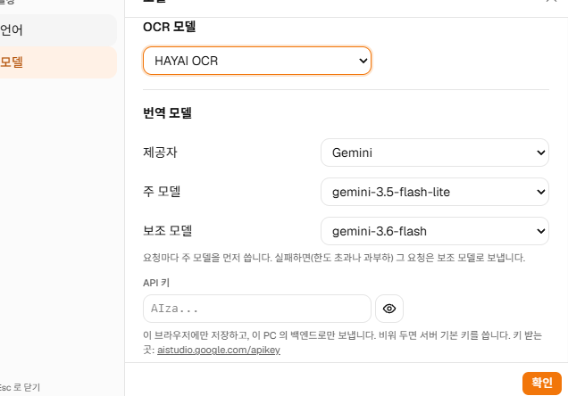
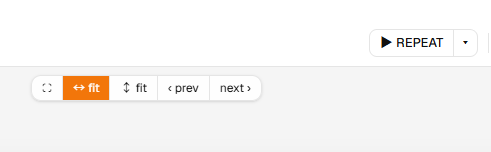

# Manual

## 1. 번역
- 우상단에 있는 process 버튼을 눌러주세요  
 

  

- 현재 페이지가 기본으로 선택이 됩니다.
- Text는 일반대사(말풍선, 나레이션, 캡션) 번역을 sound effects 는 효과음을 나타냅니다.
- 효과음도 번역하고 싶은경우 체크를 하셔야 합니다.

## 2. API key
- 처음 사용하시게될 경우에는 api key가 필요하게 될텐데 제미나이를 사용하시는것을 추천드립니다.
- 안내하는 주소로 들어가여 key를 발급받아 입력해주세요.

- 번역 퀄리티는 flash 가 더좋으나 느리고 안될때가 좀있습니다. 퀄리티를 중시하면 flash 로 하시고 상관없으시면 flash lite를 추천드립니다.
- flash 가 **api 호출 횟수 제한**이 있기때문에 하실거면 한번에 여러장을 번역하시기 바랍니다.

<!-- TODO:  -->

## 3. 결과

- 번역이 완료된 경우 우측에 페이지의 대사들이 뜨며 글을 수정하거나 폰트를 변경하실수 있습니다.
- 우측상단 export 를 눌러 내보낼수 있습니다.
- original -> 원본 , Erased -> 글자 인페인팅 , Translated -> 번역 완성본

## 4. 효과음 
- 앱이 탐지하지 못한 효과음이나 대사가 있을수 있습니다. 이떄는 사용자가 탐지영역을 직접 선택하여 앱에 넘겨줄수 있습니다.
- '+' 버튼을 눌러 탐지영역 추가, 삭제, 영역 모두 삭제를 선택할수 있습니다.
- 5번째에 있는 링크는 글자 2개가 떨어져 있지만 같이 읽어야 할떄 두개의 상자를 연결합니다.
- ex ) 콰 (중간에 캐릭터) 앙 -> 이때 서로 연결하지 않으면 콰 ->한글자 번역이 되어 어색해집니다.
- 6번째(브러쉬 모양)는 인페인팅 기능입니다.

  

## 6. 설정
- 우하단의 settings 를 눌러 언어, 모델을 변경하실수 있습니다.
- 효과음의 auto 는 글자 크기에 맞는 폰트를 자동으로 넣습니다. 변경가능.

- ocr은 글자를 읽는 모델로 기본은 HAYAI고 만약 장문일시 paddle ocr로 변경을 추천드립니다.

## 7. 번외
- 방향키로 페이지를 넘길수있으며 f를 누르면 전체화면으로 볼수있습니다.
- repeat은 화면을 자동으로 넘겨주는 기능으로 사용자가 간격조정을 할수있으며 끝에도달하면 처음으로 돌아갑니다.

